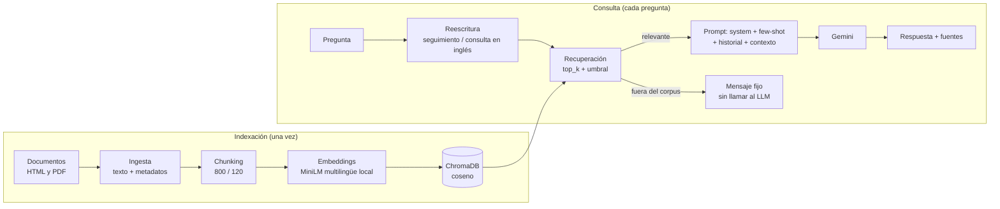

# SpringRAG — Asistente experto en Java, Maven y Spring Boot

Asistente conversacional basado en **RAG** (Retrieval-Augmented Generation) que responde preguntas y ayuda a
diagnosticar errores de Java, Maven y Spring Boot **usando solo documentación oficial indexada**, y cita el
fragmento que respalda cada respuesta.

- **Aplicación desplegada:** `PENDIENTE: pega aquí la URL pública de Streamlit Cloud`
- **Repositorio:** `PENDIENTE: pega aquí la URL del repositorio`
- Proyecto de la asignatura *Desarrollo de aplicaciones con IA* — Avance 2.

> **Control de datos.** El corpus y el índice vectorial se mantienen bajo nuestro control: los documentos se
> vectorizan con un modelo local y **al LLM solo se le envían los fragmentos recuperados para cada consulta,
> nunca el corpus completo**.

---

## 1. Flujo RAG implementado



| Etapa | Decisión | Por qué |
|---|---|---|
| **Corpus** | 17 documentos oficiales: Spring Boot (config, perfiles, logging, auto-configuración, web, Actuator, SQL, how-to, plugin Maven), Spring Framework (DI, `@Transactional`), Maven (dependencias, ciclo de vida, POM) y la guía de *troubleshooting* de Java 21 (PDF) | Cubren el alcance del asistente (errores de arranque, `application.properties`/YAML, dependencias, logs) y son verificables por URL |
| **Ingesta** | HTML con BeautifulSoup (por secciones `h1–h3`), PDF con pypdf (por página); también DOCX y TXT | Cada sección conserva su título para citar y para no mezclar temas |
| **Chunking** | 800 caracteres, solapamiento 120 (15 %), corte recursivo (párrafo > línea > frase > palabra) y encabezado `Título > Sección` en cada chunk | Un chunk ≈ una idea completa; el solapamiento evita cortar ejemplos en el borde |
| **Embeddings** | `paraphrase-multilingual-MiniLM-L12-v2` (384 dim) vía `fastembed`, **local** | Multilingüe (preguntas en español, docs en inglés), ligero para el servidor gratuito, el corpus no sale del sistema |
| **Base vectorial** | ChromaDB persistente (`data/chroma/`), distancia coseno | Sin servidor; metadatos para citar: título, URL, sección, página, tipo, `chunk_id` |
| **Recuperación** | Similitud, `top_k=4`, umbral de distancia 0.60 | El umbral se calibró midiendo preguntas del dominio (hasta 0.58) frente a ajenas (desde 0.55 a 0.81) |
| **Generación** | Gemini (`gemini-3.5-flash-lite`), temperatura 0.2, system prompt + 3 ejemplos few-shot + últimos 3 turnos | Reutiliza y refina el prompt del Avance 1: responde solo con el contexto, cita `[n]` y se niega con una frase fija cuando no sabe |
| **Conversación** | Reescritura de la pregunta antes de buscar (resuelve seguimientos y la traduce al inglés) + historial en `st.session_state` | "¿y en YAML?" se convierte en una búsqueda con sentido; buscar en inglés mejoró la recuperación (ver sección 4). Se desactiva con `SEARCH_IN_ENGLISH=false` |
| **Control de alucinaciones** | 1) umbral de distancia: fuera del corpus no se llama al LLM; 2) el prompt obliga a responder solo con el contexto | Dos barreras independientes |

### Prompt (resumen)
`springrag/prompts.py` contiene: `SYSTEM_PROMPT` (rol, reglas, formato de salida), `USER_TEMPLATE` (contexto en un
bloque ```` ```text ```` + pregunta), tres ejemplos *few-shot* (error claro, faltan datos y contexto que no responde)
y los prompts de reescritura. Formato de salida: para errores, *Diagnóstico / Posibles causas / Qué revisaría
primero / Información que hace falta*; para conceptos, *Respuesta*. Las fuentes las muestra la interfaz.

---

## 2. Estructura del repositorio

```
├── app.py                    # Interfaz de chat (Streamlit)
├── springrag/                # Pipeline RAG
│   ├── config.py             #   parámetros (chunk, top_k, umbral, modelos)
│   ├── sources.py            #   catálogo del corpus
│   ├── ingest.py             #   HTML / PDF / DOCX / TXT -> texto + metadatos
│   ├── chunking.py           #   fragmentación
│   ├── embeddings.py         #   vectorización local
│   ├── vectorstore.py        #   índice ChromaDB
│   ├── retriever.py          #   búsqueda top_k + umbral
│   ├── prompts.py            #   system prompt, few-shot, plantillas
│   ├── llm.py                #   cliente Gemini (reintentos, cuota)
│   └── pipeline.py           #   flujo completo con historial
├── scripts/                  # download_corpus, build_index, ask, test_*...
├── eval/                     # dataset.json, run_ragas.py, compare.py, results/
├── data/chroma/              # índice vectorial persistido (versionado)
├── requirements.txt          # dependencias de la app (versiones fijadas)
├── requirements-eval.txt     # dependencias extra para Ragas
└── .streamlit/               # tema y plantilla de secrets
```

---

## 3. Instalación y ejecución local

Requisitos: Python 3.10+ y una API key gratuita de Google AI Studio (https://aistudio.google.com/apikey).

```powershell
# 1) Entorno virtual e instalación
python -m venv .venv
.\.venv\Scripts\Activate.ps1
pip install -r requirements.txt
pip install -e .

# 2) Clave de API (el archivo .env NO se sube a Git)
copy .env.example .env      # y edita GOOGLE_API_KEY=...

# 3) Preparar la base de conocimiento (el repositorio ya trae data/chroma/; esto es para reconstruirla)
python scripts/download_corpus.py
python scripts/build_index.py

# 4) Probar el pipeline por terminal
python scripts/ask.py "¿Cómo cambio el puerto del servidor?"

# 5) Abrir la interfaz de chat en http://localhost:8501
streamlit run app.py
```

Para reconstruir el índice con otros parámetros:
`python scripts/build_index.py --chunk-size 1200 --overlap 200 --collection springrag_otra`.

---

## 4. Evaluación con Ragas

Dataset: `eval/dataset.json` — 22 preguntas con respuesta de referencia (*ground truth*): **18 con respuesta en el
corpus** y **4 fuera de la base de conocimiento** para medir el control de alucinaciones. Cada referencia se
verificó contra el texto real de los documentos.

```powershell
pip install -r requirements-eval.txt
python eval/run_ragas.py --name baseline        # evaluación de la línea base
python eval/run_ragas.py --name iter1_english   # iteración de mejora (consulta en inglés)
python eval/compare.py baseline iter1_english   # tabla y gráfico antes/después
```

Métricas: `faithfulness`, `answer_relevancy`, `context_precision`, `context_recall` (juez: Gemini 3.5 Flash-Lite;
sobre las 18 preguntas del corpus). Las 4 preguntas fuera del corpus se miden aparte con la **tasa de rechazo
correcto**. Los resultados por pregunta están en `eval/results/`.

### Resultados: línea base y iteración de mejora

| Métrica (18 preguntas del corpus) | Línea base | Con la mejora | Cambio |
|---|---|---|---|
| faithfulness | 0.876 | 0.972 | +0.096 |
| answer_relevancy | 0.662 | 0.674 | +0.012 |
| **context_precision** | **0.520** | 0.711 | **+0.191** |
| context_recall | 0.694 | 0.815 | +0.121 |
| Rechazo correcto fuera del corpus (4 preguntas) | 4/4 | 4/4 | = |
| Falsos rechazos dentro del corpus (18 preguntas) | 2/18 | 0/18 | −2 |

Tabla y gráfico generados con `python eval/compare.py baseline iter1_english` (`eval/results/comparison.md`).

**Análisis de la línea base.**
- La métrica más baja fue **`context_precision` (0.52)**, seguida de `context_recall` (0.69). Ambas miden la
  **recuperación**: en muchas preguntas el buscador traía fragmentos poco útiles o no traía el que contenía el dato.
  `faithfulness` (0.88) fue la más alta: cuando el contexto sirve, el modelo no inventa. Dos preguntas del corpus
  (`q10` y `q14`) fueron rechazadas por error porque el dato no llegó en los fragmentos recuperados.
- **Componente responsable: recuperación** (no el chunking ni la generación). Se descartó el chunking midiendo, sin
  usar el LLM, si el dato clave aparecía entre los fragmentos recuperados: con chunk de 1200 empeoró (11/18 frente a
  13/18) y subir `top_k` de 4 a 6 no cambió nada (13/18). La causa más probable es que el modelo de embeddings,
  pequeño, empareja peor una pregunta en español con documentación escrita en inglés.
- **Qué se hizo para mejorarla:** una sola modificación del prompt de búsqueda.

**Iteración de mejora: consulta de búsqueda en inglés.** Antes de buscar, el LLM traduce la pregunta al inglés
(una llamada extra por pregunta); el índice, `top_k` y el prompt de generación no cambian. La respuesta sigue siendo en
español. Resultado: mejoran las cuatro métricas, sobre todo `context_precision` (+0.19) y `context_recall` (+0.12),
y desaparecen los falsos rechazos.

Hallazgos del proceso (documentados porque cambian cómo leer los resultados):
- *Primera versión del prompt de traducción:* subía `context_precision` a 0.656, pero añadía palabras de Spring a las
  preguntas ajenas ("Django con PostgreSQL" se convertía en `spring boot configure datasource postgresql`), de modo
  que el umbral dejaba de bloquearlas y solo las detenía el prompt. Se corrigió exigiendo traducción fiel (resultado
  final: Django y pizza vuelven a ser bloqueadas por el umbral). Los resultados de esa versión se conservan en
  `eval/results/iter1_english_v0_*`.
- *Preguntas de seguimiento:* el prompt de traducción literal no resolvía referencias ("¿y en YAML?" → "how do I do
  it in YAML"), así que los seguimientos usan un prompt propio que primero incorpora el tema de la conversación. La
  evaluación es de una sola pregunta, por lo que este caso se verificó aparte.

**Cómo leer estos números (limitaciones).** Es una sola ejecución con 18 preguntas y un juez pequeño: la desviación
entre preguntas es alta (≈0.35 en precisión y recall) y `answer_relevancy` varía mucho de una pregunta a otra
(el +0.012 no es una mejora significativa). Las preguntas `q03`, `q15` y `q04` siguen con recuperación débil; mejorarlas
requeriría otro enfoque (por ejemplo búsqueda híbrida con palabras clave o un modelo de embeddings mayor).

---

## 5. Despliegue en Streamlit Community Cloud

1. Sube el proyecto a GitHub (**incluye `data/chroma/`; el archivo `.env` queda excluido por `.gitignore`**).
2. Entra a https://share.streamlit.io con tu cuenta de GitHub → **Create app** → *Deploy a public app from GitHub*.
3. Elige el repositorio, la rama `main` y como *Main file path* `app.py`.
4. En **Advanced settings**: elige **Python 3.12** y en **Secrets** pega:
   ```toml
   GOOGLE_API_KEY = "tu_clave_real"
   ```
5. Pulsa **Deploy**. La primera carga tarda unos minutos (instala dependencias y descarga el modelo de embeddings).
6. Copia la URL pública (`https://<nombre>.streamlit.app`) y pégala arriba en este README.

La clave **nunca** está en el repositorio: se lee de `st.secrets` (nube) o de `.env` (local).

---

## 6. Limitaciones conocidas

- **Cuotas del plan gratuito de Gemini** (`gemini-3.5-flash-lite`): 15 peticiones por minuto y **500 por día por
  proyecto**. Cada pregunta usa 2 llamadas (traducir y responder; 1 si queda fuera del corpus), así que la app admite
  unas 250 preguntas al día compartidas entre todos los usuarios. Si se agota la cuota diaria la app lo informa con un
  mensaje claro (`CuotaAgotada`) y se renueva al día siguiente. Una evaluación completa de Ragas consume por sí sola
  unas 200 a 300 llamadas.
- **Recuperación**: el modelo de embeddings pequeño empareja peor algunas preguntas en español con texto técnico en
  inglés (ver análisis de resultados).
- **Juez de evaluación**: es un modelo pequeño y gratuito; los veredictos pueden variar entre ejecuciones, y con 18
  preguntas cada promedio es sensible a una sola respuesta.
- El historial de la conversación vive en la sesión del navegador y se pierde al cerrarla.
